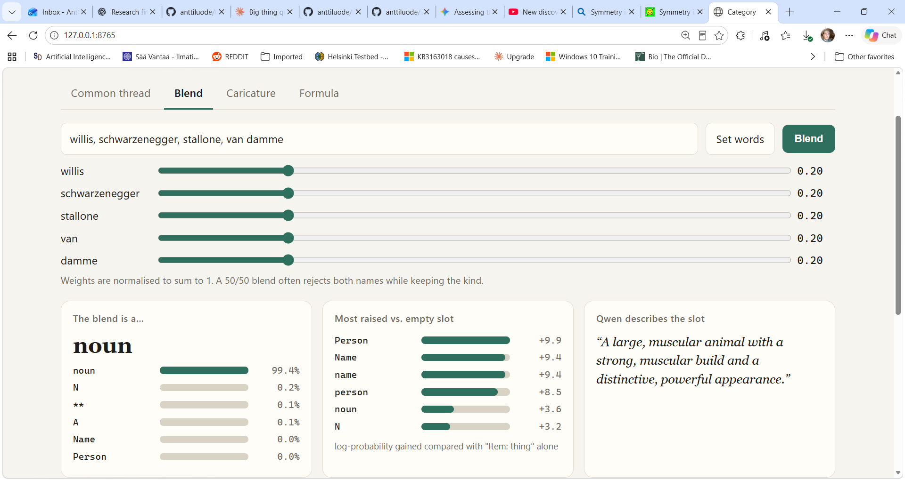

# Category



A live window into a frozen Qwen. Type words. Their hidden states are averaged, blended or combined, written into an empty slot, and then Qwen is asked what it is holding.

It is the RakeisuusClaude result turned into a tool. There, averaging a word's state with its siblings made the word's identity fade while its kind got louder (all 22 held-out leaves, against 0 of 22 for an equal-size random move). Here you can try that on any words you like.

## Run (Windows, RTX 3060)

```
cd D:\anttiluode
git clone https://github.com/anttiluode/Category
cd Category
python3.13 category.py --self-test
python3.13 category.py
```

The page opens at http://127.0.0.1:8765/. The model is `Qwen/Qwen3-1.7B`, the same checkpoint as RakeisuusClaude, so it comes from your Hugging Face cache. Each query takes a second or two on the GPU.

- `--dtype bfloat16` halves memory if needed.
- `--band-end 8` changes the last clamped layer.
- `--ask "oak, pine, elm"` runs one query in the terminal.
- `--stub` runs the page on a tiny random model, to check it works without Qwen.

On Windows you can also double-click `run_category.bat`.

## How it works

1. Each word's state is read at its own position in `Item: <word>`, at every layer from the token embedding to layer 12. Thanks to causal attention, nothing after the word affects it.
2. The states are combined layer by layer: averaged, weighted, or added and subtracted.
3. The result is clamped into the slot `Item: thing`, from the embedding through layer 12. The word *thing* never exists in the forward pass, so nothing can route around the clamp. The self-test checks this: a word clamped through every layer gives exactly the answers of the prompt that prints it.
4. Qwen is then asked three kinds of question about the slot:
   - **What kind of thing is it?** This is open-ended and never names a category. The page shows the most likely answers, and the answers most raised compared with an empty `Item: thing`.
   - **Describe it** in one sentence, without naming it. This is greedy generation from the clamped slot.
   - **Is it a <word>?** This gives yes-minus-no evidence in nats, minus the same evidence for an empty slot. Positive means Qwen says yes more than it would for "thing".

## The tabs

| Tab | What it computes |
|---|---|
| **Common thread** | The average of all the words, plus what each word is alone. Red bars under "is the average still each word?" mean the average has dropped that word's identity. |
| **Odd one out** | Each word is left out in turn. The others' average names a kind, and then the left-out word alone is asked whether it is that kind. The word with the lowest evidence is the odd one. |
| **Blend** | A weighted mix with sliders. At 50/50 two siblings often lose both names and keep the kind. |
| **Caricature** | word + α·(word − average of its kin). At α = −1 you get the kin's average, at 0 the word itself, and above 0 the word exaggerated. The chart sweeps α, showing "is it the word?" against "is it the kin's kind?". If the picture from RakeisuusClaude holds, the two lines cross. |
| **Formula** | Free arithmetic: `maple - [oak pine elm cedar] + [eagle owl crow]` puts a maple's private part on a bird's core. `[...]` is a group average. Rescaling keeps the result at a word's typical length. |

## Things worth trying

- Groups that share a function, not a taxonomy: `knife, glass, thorn, needle` (sharp?), `brick, hammer, book, rock` (could hold a door open?), `sun, fire, lava, stove` (hot?).
- The intruder sweep: `piano, guitar, drum, hammer`, then add more tools one at a time and watch where "instrument" gives way.
- Caricature of a weak member, such as maple, which unblurred Qwen doesn't even call a tree.
- Formula: does a tree's private residue mean anything on a bird? It may well not, and that's a clean answer too.

## What it is not

- **Not new mathematics.** A category as the average of its members is prototype theory. Mean-difference steering vectors (contrastive activation addition, 2023) use the same averaging. Caricature as distance from the average comes from face-space work in psychology. The averaging result follows almost directly from a shared-plus-private picture of each state: averaging *n* words keeps the shared part and shrinks the private parts by about 1/√*n*.
- **Single-token words work best.** A word split into several tokens is clamped from its last token, which only carries part of the word at early layers. The page flags these.
- **One model, one prompt.** The readouts depend on the `Item: …` frame and the question wording. Evidence values are comparable within one query, not across very different questions.

## Lineage

[RakeisuusClaude](https://github.com/anttiluode/RakeisuusClaude) (the clamp, the band, the neutral-slot calibration, Gate 3), [GrainLensSol](https://github.com/anttiluode/GrainLensSol) (bypass controls), [Sihti](https://github.com/anttiluode/Sihti) (the identity-fades, kind-rises curve), [Qwenimagination](https://github.com/anttiluode/Qwenimagination) (where in the model a concept can be steered).
